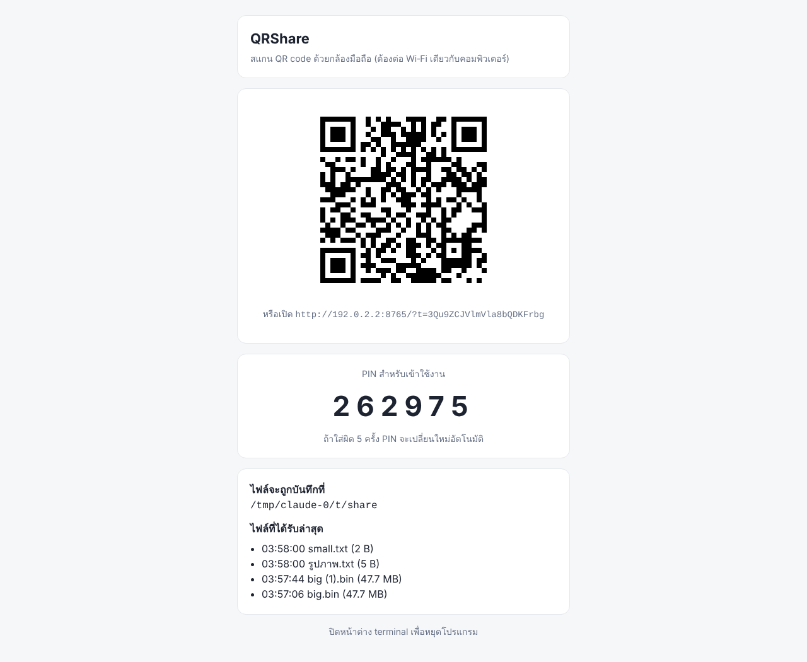
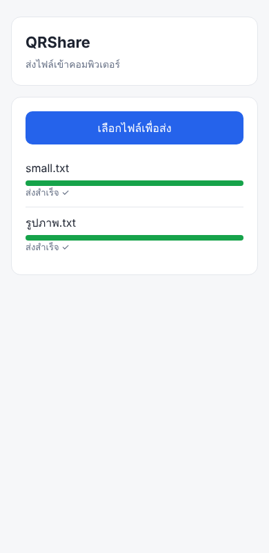
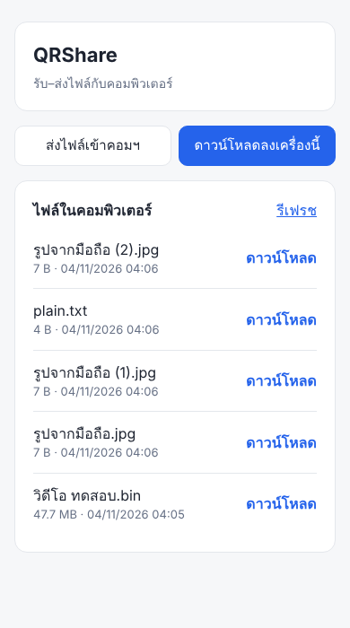

# QRShare

รับ–ส่งไฟล์ระหว่างมือถือ/แท็บเล็ตกับคอมพิวเตอร์ผ่าน Wi‑Fi เดียวกัน แค่สแกน QR code และใส่ PIN
มือถือไม่ต้องลงแอป ใช้ได้ทั้ง iPhone และ Android

| หน้าจอคอมพิวเตอร์ | ส่งไฟล์จากมือถือ | ดาวน์โหลดลงมือถือ |
|---|---|---|
|  |  |  |

## ดาวน์โหลดโปรแกรม

ไปที่หน้า **[Releases](../../releases/latest)** แล้วดาวน์โหลด

- **Windows:** `QRShare-Windows.zip` แตกไฟล์แล้วได้ `QRShare.exe`
- **Mac:** `QRShare-Mac.zip` แตกไฟล์แล้วได้ `QRShare.app` (รองรับ Mac ชิป Apple M1 ขึ้นไป)

ไม่ต้องติดตั้ง Python หรือโปรแกรมอื่นเพิ่ม

## เปิดครั้งแรก

โปรแกรมนี้ไม่ได้ซื้อใบรับรองผู้พัฒนา ครั้งแรกระบบจะเตือน ให้อนุญาตแบบนี้ (ทำครั้งเดียว)

**Windows**
1. ดับเบิลคลิก `QRShare.exe` ถ้าขึ้น "Windows protected your PC" ให้กด **More info** แล้วกด **Run anyway**
2. ถ้าขึ้นหน้าต่าง Windows Firewall ให้ติ๊ก **Private networks** แล้วกด **Allow access**

**Mac**
1. ดับเบิลคลิก `QRShare.app` ถ้าขึ้นว่าเปิดไม่ได้ ให้กด **Done**
2. ไปที่ **System Settings → Privacy & Security** เลื่อนลงมาจะเห็น QRShare ให้กด **Open Anyway**
3. ถ้าถามเรื่องการรับการเชื่อมต่อจากเครือข่าย ให้กด **Allow**

## วิธีใช้

1. เปิดโปรแกรม เบราว์เซอร์จะแสดง QR code และ PIN 6 หลัก
2. ใช้กล้องมือถือสแกน QR code แล้วใส่ PIN
3. แท็บ **ส่งไฟล์เข้าคอมฯ**: เลือกไฟล์ได้หลายไฟล์พร้อมกัน ไฟล์จะไปอยู่ในโฟลเดอร์แชร์
4. แท็บ **ดาวน์โหลดลงเครื่องนี้**: เห็นไฟล์ในโฟลเดอร์แชร์ กดเพื่อดาวน์โหลด
   (อยากส่งไฟล์จากคอมฯ ไปมือถือ ก็แค่ก๊อปไฟล์ใส่โฟลเดอร์แชร์)
5. โฟลเดอร์แชร์คือ `Documents/QRShare` กดปุ่ม **เปิดโฟลเดอร์แชร์** บนหน้าจอคอมฯ เพื่อเปิดดู
6. ใช้เสร็จแล้วกด **หยุดโปรแกรม** (ถ้าปิดแท็บไปแล้ว ดับเบิลคลิกโปรแกรมอีกครั้งเพื่อกลับมาหน้าเดิม)

## ถ้ามือถือเปิดหน้าไม่ได้

- ตรวจว่ามือถือกับคอมฯ ต่อ Wi‑Fi วงเดียวกัน
- Windows: ตรวจว่า Wi‑Fi ตั้งเป็น **Private network** และอนุญาต QRShare ใน Firewall แล้ว
- Wi‑Fi บางที่ (โรงแรม ร้านกาแฟ บางออฟฟิศ) บล็อกไม่ให้อุปกรณ์คุยกันเอง กรณีนี้ใช้ไม่ได้
- ถ้าคอมฯ ต่อ VPN อยู่ ลองปิด VPN ก่อน

## ความปลอดภัย

- QR code มีรหัสลับแบบสุ่มที่เปลี่ยนทุกครั้งที่เปิดโปรแกรม คนที่ไม่ได้สแกนเข้าไม่ได้
- ต้องใส่ PIN อีกชั้น ใส่ผิด 5 ครั้ง PIN จะเปลี่ยนใหม่
- มือถือเห็นและดาวน์โหลดได้เฉพาะไฟล์ในโฟลเดอร์แชร์ (ไม่รวมโฟลเดอร์ย่อยและไฟล์ซ่อน) ส่วนอื่นของเครื่องเข้าไม่ได้
- หน้า QR/PIN และปุ่มหยุดโปรแกรมใช้ได้จากคอมฯ เครื่องนั้นเท่านั้น
- การส่งไม่ได้เข้ารหัส (http) จึงเหมาะกับ Wi‑Fi ที่บ้านหรือที่เชื่อถือได้

## สำหรับนักพัฒนา

```
pip install -r requirements.txt
python qrshare.py [--folder โฟลเดอร์] [--port 8765] [--no-browser]
```

ทุกครั้งที่ push ขึ้น `main` GitHub Actions จะสร้าง .exe และ .app ไว้ในหน้า Actions
ถ้า push tag ที่ขึ้นต้นด้วย `v` (เช่น `v0.1.0`) จะสร้าง Release พร้อมไฟล์ให้ดาวน์โหลด
